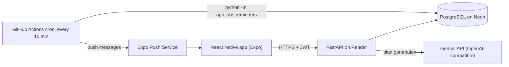

# AI Habit Coach: Backend API

[](https://github.com/tejasg99/ai-habit-coach/actions/workflows/ci.yml)

A REST API for a mobile habit and fitness app. A user completes a short onboarding, an LLM generates a personalised weekly plan, and the API tracks daily completions, streaks and progress, and sends push reminders at each user's own local time.

- **Live API docs (Swagger):** https://ai-habit-coach-6vmk.onrender.com/docs
- **Mobile app:** React Native (Expo), link coming soon

> The API runs on a free tier that sleeps after about 15 minutes without traffic. The first request after a quiet period can take up to a minute.

## Features

- Email and password auth: Argon2 password hashing, short-lived access tokens, refresh tokens
- Onboarding profile: goal, fitness level, diet, equipment, timezone, reminder time
- **AI plan generation**: a 7-day plan of workouts, meals and habits, validated against a strict schema before anything is saved
- Daily checklist, idempotent completion logging, same-day undo
- Streaks derived from logs, and per-day progress for charts (planned vs completed)
- Push reminders (Expo) at the user's local time, sent only if they haven't started the day; users can opt out
- Account deletion that removes all of a user's data
- Login throttling: 5 failed attempts per email within 15 minutes pauses further attempts (HTTP 429 with Retry-After)

## Architecture



## Tech stack

| Area | Choice |
|---|---|
| Language / framework | Python 3.12, FastAPI, Pydantic v2 |
| Database | PostgreSQL (Neon), SQLAlchemy 2.0, Alembic migrations |
| Auth | PyJWT (access and refresh tokens), Argon2 via pwdlib |
| LLM | Gemini through its OpenAI-compatible endpoint, called with httpx |
| Notifications | Expo Push Service |
| Tooling | pytest, Ruff, Docker, GitHub Actions |
| Hosting | Render (API), Neon (database), GitHub Actions (scheduled reminders) |

## API overview

| Method | Path | Purpose | Auth |
|---|---|---|---|
| POST | `/auth/signup` | Create an account | No |
| POST | `/auth/login` | Log in (form-encoded; email goes in `username`; throttled after repeated failures) | No |
| POST | `/auth/refresh` | Exchange a refresh token for a new token pair | No |
| GET / PATCH / DELETE | `/users/me` | Read, update or delete the account | Yes |
| PUT / GET / PATCH | `/onboarding/me` | Create, read or update the profile | Yes |
| POST | `/plan/generate` | Generate a new weekly plan with the LLM | Yes |
| GET | `/plan/today`, `/plan/week` | Today's checklist, or the whole plan | Yes |
| POST / DELETE | `/logs`, `/logs/{id}` | Mark an item done, or undo it (same day only) | Yes |
| GET | `/progress`, `/progress/streak` | Chart data, and streak numbers | Yes |
| POST | `/notifications/register-token`, `/notifications/unregister-token` | Manage push tokens | Yes |
| GET | `/health`, `/health/db` | Liveness and database checks | No |

## Design decisions

1. **Layered code.** Routes handle HTTP only, services hold the logic, models describe storage. Anything with real logic (streaks, reminder windows, progress) is a pure function over plain data, so it is tested without a database.
2. **Constraints over checks.** Idempotency lives in the database: unique emails, one completion per item per day, one active plan per user (a partial unique index), one reminder per user per day. Application checks are a courtesy, and the constraint is the guarantee. Races cannot break them.
3. **LLM output is untrusted input.** Responses are cleaned, parsed and validated against a strict schema, retried when invalid, and never stored otherwise. The raw response and a prompt version are kept for debugging. The user's profile is passed to the model as data (and equipment names are allow-listed), not spliced into instructions.
4. **Streaks are derived, not stored.** They are computed from the completion logs, so they cannot drift out of sync with the source of truth.
5. **"Today" belongs to the user.** The server decides the date from the user's timezone, in one function. The client never sends a date, so a wrong phone clock cannot fake a streak.
6. **Authorization by query scoping.** No endpoint accepts a user id. Every query is filtered by the authenticated user, and another user's resources return 404 (never 403), so ids cannot be probed.
7. **History-aware progress.** Each past day is judged against the plan that was active that day, so regenerating a plan never rewrites history. The number of SQL queries does not grow with the requested time window, and a test enforces it.
8. **Reminders that tolerate unreliable schedulers.** A sweep finds users inside their local reminder window and claims the day in a ledger before sending. Late, repeated or overlapping runs cannot send duplicates, and dead device tokens are pruned automatically.
9. **Fail fast on configuration.** Typed settings, production guards (for example, a short secret key refuses to start), and no secrets in the image or the repository.
10. **Tests at the boundaries.** The LLM and Expo are replaced by fakes, each test gets a fresh in-memory database, and CI separately applies every migration to a real PostgreSQL, checks that models and migrations agree, and builds the Docker image.
11. **Throttling with stated trade-offs.** Failed logins are counted per email, including emails that don't exist (no account enumeration), and blocked attempts are not counted (no permanent lockout). There is deliberately no IP-based limit: behind a proxy the client IP is spoofable, so that belongs at the network edge.
12. **Reproducible, audited dependencies.** `requirements.in` lists what I chose; `requirements.txt` is a generated lock with every package pinned for all platforms; CI audits the pins for known vulnerabilities.
13. **A committed API contract.** `docs/openapi.json` is exported from the app and checked by a test, so any change to the API's shape fails CI until it is regenerated and reviewed. This keeps the mobile client from breaking silently.
14. **Traceable requests.** Every request gets an ID returned in X-Request-ID and attached to every log line, and tests assert that credentials never reach the logs.

## Quick tour

```bash
BASE=https://ai-habit-coach-6vmk.onrender.com

# Sign up, then log in (login is form-encoded)
curl -X POST $BASE/auth/signup -H "Content-Type: application/json" \
  -d '{"email":"me@example.com","password":"correct-horse-battery"}'
TOKEN=$(curl -s -X POST $BASE/auth/login \
  -d "username=me@example.com&password=correct-horse-battery" \
  | python -c "import sys, json; print(json.load(sys.stdin)['access_token'])")

# Onboard
curl -X PUT $BASE/onboarding/me -H "Authorization: Bearer $TOKEN" -H "Content-Type: application/json" \
  -d '{"goal":"build_muscle","fitness_level":"beginner","dietary_pref":"vegetarian","equipment":["dumbbells"],"timezone":"Asia/Kolkata","reminder_time":"19:30:00"}'

# Generate a plan, then fetch today's checklist
curl -X POST $BASE/plan/generate -H "Authorization: Bearer $TOKEN"
curl $BASE/plan/today -H "Authorization: Bearer $TOKEN"
```

## Run locally

```bash
git clone https://github.com/tejasg99/ai-habit-coach.git
cd ai-habit-coach

python -m venv .venv
source .venv/bin/activate          # Windows Git Bash: source .venv/Scripts/activate
pip install -r requirements-dev.txt

cp .env.example .env               # then set SECRET_KEY (the command is in the file)
docker compose up -d db            # local PostgreSQL
alembic upgrade head
uvicorn app.main:app --reload      # http://localhost:8000/docs
```

If port 5432 is already taken on your machine, change the left side of the `ports` mapping in `docker-compose.yml` and the port in `DATABASE_URL` so they match.

To run the whole stack in containers instead: `docker compose up --build api`.

### Managing dependencies

Edit `requirements.in` (runtime) or `requirements-dev.in` (tools), then regenerate the locks. Never edit the `.txt` files by hand.

```bash
uv pip compile requirements.in -o requirements.txt --universal --python-version 3.12
uv pip compile requirements-dev.in -o requirements-dev.txt --universal --python-version 3.12
```

Add `--upgrade` to move every package to its newest allowed version (run the tests afterwards).

## Configuration

All configuration comes from environment variables (see `.env.example`).

| Variable | Required | Purpose |
|---|---|---|
| `DATABASE_URL` | Yes | PostgreSQL connection string |
| `SECRET_KEY` | Yes | Signs tokens (at least 32 characters when `ENVIRONMENT=production`) |
| `ENVIRONMENT` | No | `development` (default) or `production` |
| `ACCESS_TOKEN_EXPIRE_MINUTES`, `REFRESH_TOKEN_EXPIRE_DAYS` | No | Token lifetimes (30 minutes, 30 days) |
| `LLM_API_KEY`, `LLM_MODEL`, `LLM_BASE_URL` | For plan generation | Any OpenAI-compatible chat endpoint |
| `LLM_TIMEOUT_SECONDS`, `LLM_MAX_ATTEMPTS` | No | Timeout and retry budget for LLM calls |
| `EXPO_PUSH_URL`, `EXPO_ACCESS_TOKEN` | No | Expo push endpoint, and an optional access token |
| `SCHEDULER_ENABLED`, `REMINDER_SWEEP_MINUTES` | No | In-process reminder scheduler (development convenience) |

## Testing and CI

```bash
pytest                                  # no database needed: in-memory SQLite
ruff check . && ruff format --check .
```

GitHub Actions runs four jobs on every push: tests and linting; migrations against a real PostgreSQL (upgrade, check that models and migrations agree, full downgrade and upgrade); a Docker image build; and a dependency vulnerability audit. A contract test fails if the OpenAPI document changes without the committed snapshot being regenerated (python -m scripts.export_openapi).

## Deployment

- The API runs from the Dockerfile on Render. The container applies migrations on start, then runs Uvicorn as a non-root user.
- PostgreSQL is hosted on Neon.
- Reminders run from a scheduled GitHub Actions workflow (`python -m app.jobs.reminders`), because a free web service that sleeps cannot run its own scheduler. Scheduled workflows can run late, which the reminder window and ledger are designed to absorb.

## Limitations and roadmap

- Plan generation is synchronous and can take a while. A production version would return `202 Accepted` and let the app poll a status endpoint.
- Push tickets are handled, but delivery receipts are not yet polled to prune tokens that die after acceptance.
- Free-tier cold starts (see the note at the top).
- Planned next: push delivery-receipt handling, asynchronous plan generation, and the React Native client.
